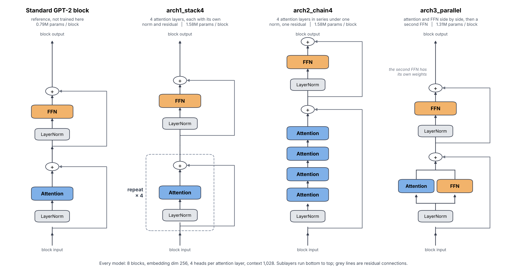
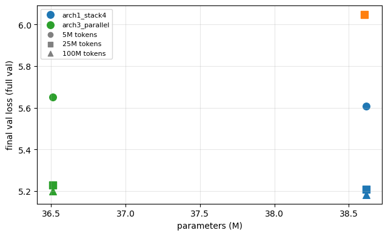
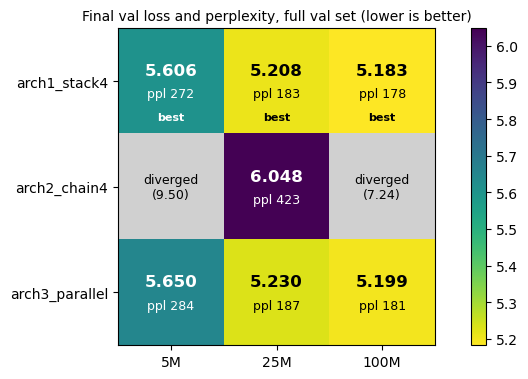
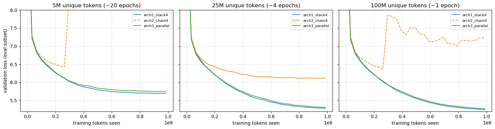
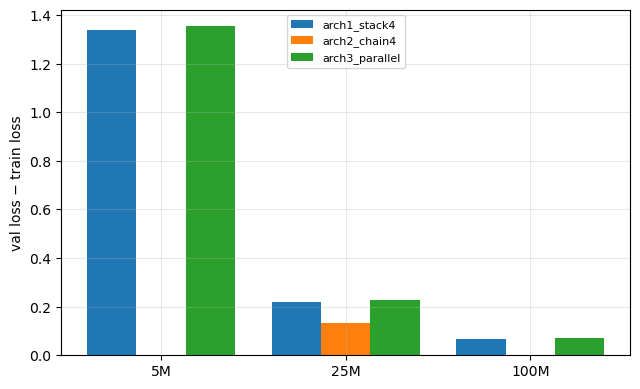
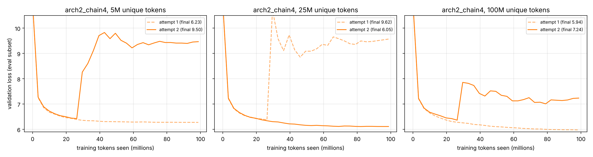

# Rethinking the transformer block: three attention layouts, small data

Three GPT variants (about 37–39M parameters each) that differ **only in how attention and feed-forward layers are wired inside a block**, each pretrained from scratch on 5M, 25M and 100M tokens of FineWeb-Edu and compared on held-out validation loss.

> **Highlights**
> - **`arch3_parallel` stays within 0.3–0.8% of the best model's validation loss while being much cheaper.** Its blocks have **16.7% fewer parameters** (5.5% fewer overall, because about 26M embedding parameters are shared by all three) and need roughly **35% fewer forward FLOPs** per sequence.
> - **`arch1_stack4` is slightly ahead of `arch3_parallel` at every dataset size**, by 0.044, 0.022 and 0.017 validation loss. The gap shrinks as data grows. With one seed per run I read this as "comparable", not as a win for either.
> - **`arch2_chain4` is the cautionary tale.** Four attention layers in series under one residual is both worse (0.6 to 0.8 validation loss behind when it trains) and unstable: **3 of its 6 runs diverged, always at the same point in training.**
> - Everything ran on one RTX 5060 laptop GPU (8 GB), on an identical 100M-token compute budget per run.



## The three architectures

Every model has 8 blocks, embedding dimension 256, 4 heads per attention layer, context length 1,028, GPT-2 BPE vocabulary and dropout 0.2. A standard GPT-2 block (leftmost in the diagram) has one attention layer then one FFN, each with its own LayerNorm and residual connection. The three variants below change that layout. The standard block was **not** trained here; it is drawn for reference.

### `arch1_stack4`: stack four attention layers
Each block applies **four attention layers in sequence**. Each one is wrapped exactly like a normal GPT sublayer (LayerNorm, attention, residual add), and an FFN follows. It is the standard recipe with the attention sublayer repeated four times, so it gives the model the most attention-based mixing per block.

### `arch2_chain4`: chain four attention layers under one residual
Four attention layers run **back to back on a single normalised input**, with only one residual connection around the whole chain, followed by the usual FFN. It has almost the same parameter count as arch1 (12,288 fewer in total), but the signal passes through four attention operations with no skip path in between. This is the hardest of the three to train (see below).

### `arch3_parallel`: attention and FFN in parallel, then a second FFN
Attention and an FFN **read the same normalised input and their outputs are summed into the residual in one step**. A second FFN with its own weights then follows in the usual sequential way. Each block therefore has one attention layer and two FFNs, so it is a leaner block. (Computing attention and the FFN in parallel is the formulation used by GPT-J and PaLM; this variant combines it with an extra sequential FFN.)

| | Standard GPT-2 block (reference) | arch1_stack4 | arch2_chain4 | arch3_parallel |
|---|---|---|---|---|
| Attention layers / FFNs per block | 1 / 1 | 4 / 1 | 4 / 1 | **1 / 2** |
| Sequential sublayers per block | 2 | 5 | 5 | **2** |
| Parameters per block | 0.79M | 1.58M | 1.58M | **1.31M** |
| Transformer-block parameters (8 blocks) | 6.31M | 12.62M | 12.61M | **10.52M** |
| **Total parameters** | 32.31M | 38.62M | 38.60M | **36.51M** |
| Forward FLOPs per sequence (estimate) | 48.0 G | 87.0 G | 87.0 G | **56.7 G** |

The total counts are the figures the training notebooks print (apart from the standard block, which I computed). Every model also has about 26M parameters in the token, positional and output embeddings, which is why arch3's 16.7% saving on block parameters shows up as only 5.5% overall. FLOPs are my back-of-envelope count of forward matrix multiplications for one 1,028-token sequence, at 2 FLOPs per multiply-add and including the output projection onto the 50,257-token vocabulary. They ignore softmax, normalisation and the savings from causal masking.

## Spotlight: arch3 matches arch1 with a leaner block

| arch3 relative to arch1 | 5M tokens | 25M tokens | 100M tokens |
|---|---|---|---|
| Validation loss | 5.650 vs 5.606 (+0.8%) | 5.230 vs 5.208 (+0.4%) | 5.199 vs 5.183 (+0.3%) |
| Perplexity | 284 vs 272 (+4.5%) | 187 vs 183 (+2.2%) | 181 vs 178 (+1.7%) |
| Block parameters | −16.7% | −16.7% | −16.7% |
| Total parameters | −5.5% | −5.5% | −5.5% |
| Forward FLOPs (estimate) | −35% | −35% | −35% |



Training time was not logged. From file timestamps, arch3's 25M run took about 35 minutes against about 54 for arch1, which fits the FLOP estimate, but this was not a controlled benchmark.

arch3's blocks have 2 sequential sublayers against arch1's 5, and one attention layer instead of four. One reading of the results is that, at this scale and training length, most of arch1's extra attention capacity goes unused. That is a hypothesis these experiments do not test.

## Results

Final validation loss on the full held-out set (2,918 sequences of 1,028 tokens). Lower is better.

| | 5M unique tokens | 25M unique tokens | 100M unique tokens | Params |
|---|---|---|---|---|
| **arch1_stack4** | **5.606** (ppl 272) | **5.208** (ppl 183) | **5.183** (ppl 178) | 38.62M |
| **arch3_parallel** | 5.650 (ppl 284) | 5.230 (ppl 187) | 5.199 (ppl 181) | 36.51M |
| **arch2_chain4** | diverged (9.503) | 6.048 (ppl 423) | diverged (7.236) | 38.60M |





**More unique data helps, with diminishing returns at fixed compute.** Every run sees the same 100M training tokens (6,079 updates), so the 5M subset is repeated about 20 times and the 25M subset about 4 times. For arch1, going from 5M to 25M unique tokens lowers validation loss by 0.40, while going from 25M to 100M lowers it by only 0.025. The overfitting gap (validation minus training loss) falls from about 1.3 to 0.22 to 0.07.



**Absolute losses are high.** Each model sees only 100M tokens, far below the roughly 20 tokens per parameter often quoted as compute-optimal at this size. Compare the architectures with each other, not with published models.

## Why arch2 is unstable

Across two full attempts, 3 of arch2's 6 runs diverged. All three jumped at the same evaluation, update 1,800 (about 29.6M tokens seen, learning rate about 5.1e-4), on different dataset sizes and in different attempts. arch1 and arch3 never diverged in any run. The cause is not diagnosed. The obvious suspect is the chain of four attention layers with no residual path between them, but I did not test that. A lower learning rate might fix it, which I also did not try, so the result is that arch2 is unstable **under this recipe**.

The first attempt used micro-batch 8 × 2 accumulation and plain AdamW. The second used 4 × 4 and fused AdamW, matching arch1 and arch3. The table above uses the second attempt, and both are in [`results/arch2_attempts.csv`](results/arch2_attempts.csv).



## Training setup

| | |
|---|---|
| Data | FineWeb-Edu, GPT-2 BPE tokenized into one uint16 token file (3.003B tokens). Training subsets are the first 5M / 25M / 100M tokens, so they are nested. Validation is tokens 3.000B to 3.003B, never used for training |
| Budget | 6,079 optimizer updates × 16 sequences × 1,028 tokens ≈ 100M tokens, identical for every run |
| Optimizer | AdamW, peak LR 6e-4, 200-step warmup then cosine decay to 6e-5, weight decay 0.1, gradient clipping 1.0 |
| Batching | micro-batch 4 × 4 gradient accumulation (arch2's first attempt: 8 × 2) |
| Precision | bfloat16 autocast |
| Seed | 123 for every run |
| Hardware | single RTX 5060 laptop GPU, 8 GB |

The periodic evaluations behind the loss curves use the first 50 validation batches, so they differ slightly from the final numbers, which use the full validation set.

## Repository layout

```
notebooks/
  p_2Model_1_arch1_stack4.ipynb      train arch1 at 5M, 25M, 100M
  p_2Model_2_arch2_chain4.ipynb      train arch2 (second attempt; outputs shown are from it)
  p_2Model_3_arch3_parallel.ipynb    train arch3
  p_2_analysis.ipynb                 loads logs and checkpoints; makes the figures
results/
  summary.csv                        final numbers behind the results table
  arch2_attempts.csv                 both arch2 attempts
figures/                             images used in this README
requirements.txt
```

## Reproducing

1. `pip install -r requirements.txt` (RTX 50-series GPUs need a CUDA 12.8+ build of PyTorch).
2. Prepare the token file. The training notebooks expect a GPT-2-tokenized FineWeb-Edu file at the path in their `TOKEN_FILE` variable; edit it to your location. The tokenization script is not included in this repository.
3. Run each `p_2Model_*` notebook. Each writes `<run>_<size>_losses.json` and `<run>_<size>_model.pth` to its working directory (the `.pth` files are git-ignored).
4. Put `p_2_analysis.ipynb` in the same folder as those files and run it top to bottom.

A full run of three sizes takes a few hours on a laptop GPU. A busy GPU slows it a lot, so close other processes that use it, including idle notebook kernels.

## Limitations

- **No standard GPT-2 block was trained.** The comparison is among three variants. The natural next experiment is a baseline with the standard block (32.3M parameters) to see where arch3 sits relative to it.
- **One seed per configuration.** The 0.017–0.044 gap between arch1 and arch3 could change with another seed; the gap to arch2 is far larger than seed noise would explain.
- **arch2's two attempts used slightly different batching**, and its results in the main table come from the second.
- **One model size, one learning rate, short training.** Conclusions may not transfer to larger scales.
- **The FLOP and timing figures are estimates**, not measured benchmarks.
- The per-token loss and sample-generation sections of the analysis notebook are illustrations, not statistical evidence.
